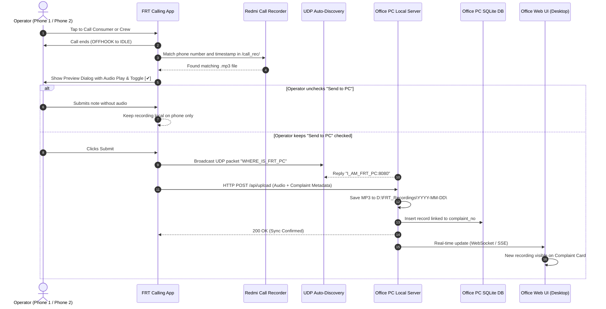
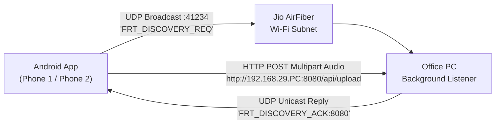

# FRT Call Recording Local Wi-Fi Sync & Management System
## Architectural Design & Step-by-Step Implementation Plan

> **Objective:** Zero-cloud-cost, 100% automated local Wi-Fi sync system to transfer call recordings from 2 Redmi Android phones (used 24/7 by control-room operators) to an Office PC running on Jio AirFiber Wi-Fi, with dynamic IP auto-discovery, operator-controlled selective uploads, multi-call aggregation per complaint, and a local desktop search/filter/audio-player UI.

---

## 1. System Overview & Key Requirements

| Requirement | Implementation Detail |
|---|---|
| **Recording Source** | Redmi MIUI/HyperOS default call recorder path: `/sdcard/MIUI/sound_recorder/call_rec/` (Format: `[Name]([Number])_[Timestamp].mp3`) |
| **Devices** | 2 Android Phones running FRT Calling App 24/7 |
| **Network** | Office Local Wi-Fi (Jio AirFiber - Dynamic Local IP) |
| **Storage Destination** | Office PC Hard Drive (e.g. `D:\FRT_Recordings\`) — Zero Cloud Storage |
| **IP Resilience** | UDP Beacon Broadcast / mDNS Auto-Discovery (No static IP or manual config required) |
| **Operator Control** | In-app recording preview + `[✔] Send to Office PC` toggle (selective submission) |
| **Complaint Mapping** | 1 Complaint -> Multiple Recordings (Consumer, Lineman/Crew, Verification) |
| **Desktop Software** | Local Web UI with Search (Complaint No, Phone, Date), Multi-call Thread View, and Built-in Audio Player |
| **Offline Resilience** | Local SQLite Pending Queue on phone when Wi-Fi drops, auto-flushes on reconnect |

---

## 2. End-to-End Workflow & Architecture



---

## 3. Data Organization & Schemas

### 3.1 Hard Drive Folder Structure (Office PC)
```text
D:\FRT_Recordings\
   └── 2026-10-27\
         └── Complaint_143655\
               ├── 01_Consumer_9311912709_131018_Op1.mp3
               ├── 02_Crew_9839012345_131840_Op1.mp3
               └── 03_Verification_9311912709_140510_Op1.mp3
         └── Complaint_143656\
               └── 01_Consumer_00916307855473_143123_Op2.mp3
```

### 3.2 Office PC Local Database Schema (`frt_local.db` - SQLite)

```sql
-- Table: complaints_meta (Stores complaint details)
CREATE TABLE IF NOT EXISTS complaints_meta (
    complaint_no TEXT PRIMARY KEY,
    consumer_name TEXT,
    consumer_phone TEXT,
    area TEXT,
    substation TEXT,
    feeder TEXT,
    complaint_type TEXT,
    complaint_date TEXT,
    created_at DATETIME DEFAULT CURRENT_TIMESTAMP
);

-- Table: call_recordings (Stores every call recording linked to a complaint)
CREATE TABLE IF NOT EXISTS call_recordings (
    id INTEGER PRIMARY KEY AUTOINCREMENT,
    complaint_no TEXT NOT NULL,
    call_target TEXT NOT NULL,         -- 'CONSUMER', 'CREW', 'VERIFICATION', 'OTHER'
    phone_number TEXT NOT NULL,
    contact_name TEXT,
    operator_id TEXT NOT NULL,         -- 'Phone_1', 'Phone_2'
    operator_name TEXT,
    call_time DATETIME NOT NULL,
    duration_seconds INTEGER DEFAULT 0,
    file_path TEXT NOT NULL,           -- Local absolute path on disk
    file_name TEXT NOT NULL,
    file_size_bytes INTEGER NOT NULL,
    call_outcome TEXT,                 -- 'Connected', 'Busy', 'Switched Off', etc.
    actual_problem TEXT,               -- Ground reality tag
    operator_notes TEXT,
    created_at DATETIME DEFAULT CURRENT_TIMESTAMP,
    FOREIGN KEY(complaint_no) REFERENCES complaints_meta(complaint_no)
);

CREATE INDEX IF NOT EXISTS idx_recordings_complaint ON call_recordings(complaint_no);
CREATE INDEX IF NOT EXISTS idx_recordings_phone ON call_recordings(phone_number);
CREATE INDEX IF NOT EXISTS idx_recordings_date ON call_recordings(call_time);
```

---

## 4. Jio AirFiber Dynamic IP Resolution (UDP Auto-Discovery)

Because Jio AirFiber router assigns dynamic local IPs via DHCP (e.g. `192.168.29.X`), hardcoding an IP is not viable.



1. **Office PC UDP Listener (`server-discovery.js`):**
   - Listens on UDP port `41234`.
   - When received `FRT_DISCOVERY_REQ`, replies immediately to sender with `FRT_DISCOVERY_ACK:8080`.
2. **Android App UDP Client:**
   - Broadcasts to `255.255.255.255:41234` on app launch and before any sync.
   - Caches the resolved IP (e.g., `192.168.29.112:8080`).
   - If an HTTP request times out, it triggers auto-discovery again transparently.
   - **Zero configuration:** Operators never touch network settings.

---

## 5. Step-by-Step Implementation Roadmap

### Phase 1: Office PC Backend & Auto-Discovery Service
- [ ] **1.1 Setup Local Service:**
  Create a lightweight Node.js/Express service at `office-server/` with:
  - SQLite database initialized with `better-sqlite3`.
  - `multer` for receiving `.mp3` audio files and saving them directly into `D:\FRT_Recordings\YYYY-MM-DD\Complaint_<ID>\`.
  - REST endpoints:
    - `POST /api/upload`: Receives audio file + metadata.
    - `GET /api/recordings`: Search with query parameters (`complaint_no`, `phone`, `date_from`, `date_to`, `operator`).
    - `GET /api/recordings/:id/stream`: Audio streaming endpoint with HTTP Range support (for audio scrub/seek).
    - `GET /api/stats`: Today's calls count, total complaints handled, storage used.
- [ ] **1.2 Setup UDP Beacon Listener:**
  Embed a Node.js `dgram` socket listening on port `41234` for automatic phone discovery.
- [ ] **1.3 Windows Auto-Start Config:**
  Create a single-click `.bat` script or Windows Service (`pm2` / `nssm`) so that whenever the office computer turns on, the server and UI start automatically in the background.

---

### Phase 2: Office PC Web UI (Dashboard Software)
- [ ] **2.1 Search & Filter Toolbar:**
  - Fast search box supporting Complaint Number, Phone Number, or Consumer Name with instant results.
  - Date Range filter: Today (default), Yesterday, This Week, Custom Date.
  - Operator filter: All, Phone 1, Phone 2.
- [ ] **2.2 Complaint Multi-Recording View (Timeline):**
  - Clicking any complaint expands a chronological conversation history:
    - `Call 1 (Consumer)` -> Audio player + notes.
    - `Call 2 (Crew)` -> Audio player + notes.
    - `Call 3 (Verification)` -> Audio player + notes.
- [ ] **2.3 Integrated Audio Player Component:**
  - In-browser playback with Play/Pause, 10s Rewind/Forward, Scrub Bar, Speed toggle (1x, 1.25x, 1.5x), and Download button.
- [ ] **2.4 Real-time Sync Indicator:**
  - Live pulse indicator showing connected phones and new recordings appearing dynamically without manual page refresh.

---

### Phase 3: Android App Modifications (Flutter + Native Kotlin)
- [ ] **3.1 Storage Permission Setup:**
  - Add `MANAGE_EXTERNAL_STORAGE` in `AndroidManifest.xml` (full permission to read `/sdcard/MIUI/sound_recorder/call_rec/` on Android 11 to 16).
  - Add native permission check in `MainActivity.kt`.
- [ ] **3.2 Native Call Recording Finder (`CallRecordingFinder.kt`):**
  - When a call transitions to `IDLE`, extract the last recorded file within 60 seconds matching:
    Regex: `\(([0-9]{10,12})\)_([0-9]{14})\.mp3$`
  - Return exact file path, duration, and file size to Flutter.
- [ ] **3.3 Flutter UI Update (`detail_sheet.dart`):**
  - Add Recording Preview widget:
    - Audio preview bar (`just_audio` local playback).
    - Checkbox: `[✔] Send to Office PC` (Defaults to true, operator can uncheck for unwanted calls).
    - Dropdown: `Called To` (`Consumer`, `FRT Crew`, `Verification`, `Other`).
- [ ] **3.4 UDP Auto-Discovery Client in Flutter:**
  - Add `raw_datagram_socket` discovery to find the Office PC IP automatically on local Wi-Fi.
- [ ] **3.5 Offline Queue Manager (`storage.dart` / SQLite):**
  - If Wi-Fi is temporarily disconnected, queue the submission locally.
  - Listen for Wi-Fi reconnection and auto-upload all pending recordings in the background.

---

### Phase 4: Integration Testing & Verification
- [ ] **4.1 Test File Extraction:**
  Verify Android app can read from `/sdcard/MIUI/sound_recorder/call_rec/` without crashing or permission denials.
- [ ] **4.2 Test Wi-Fi Dynamic IP Reconnect:**
  Simulate router restart and IP change; verify phone re-discovers PC in under 2 seconds.
- [ ] **4.3 Test Multi-Call Association:**
  Place 2 consecutive calls for the same complaint (one to consumer, one to crew); verify both attach to the single complaint thread on the Office UI.
- [ ] **4.4 Test Selective Sync:**
  Verify that when `[✔] Send to Office PC` is unchecked, no audio leaves the phone.
- [ ] **4.5 Test 2-Phone Simultaneous Usage:**
  Simulate uploads from Phone 1 and Phone 2 at the same time to ensure SQLite handles concurrent writes cleanly without locking.
